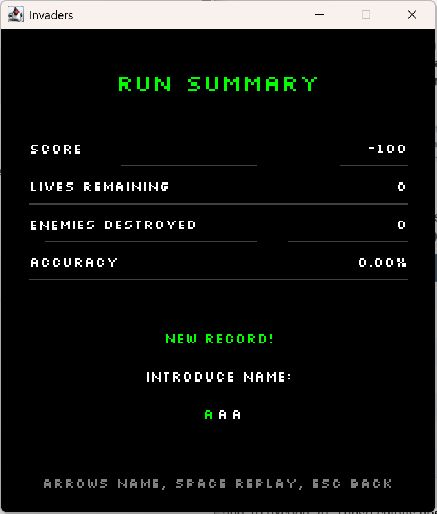

# Run summary

After a run, the summary shows score, lives remaining, enemies destroyed and accuracy.
The first row starts when the screen finishes fading in. Each row counts to its
final value over 300 ms using the linear curve from Screen Rules. All four rows
finish 1.2 seconds after the fade.

Press Space while the numbers are counting to reveal the final values. Release
Space and press it again to replay once the replay hint appears. ESC returns
to the menu after the usual input delay. If the run earns a high score, the
arrow keys edit the initials and leaving the summary saves the full score.

A run with no shots shows 0.00% accuracy. Scores can be negative. The displayed
accuracy uses the existing enemies-destroyed and shots-fired totals.

