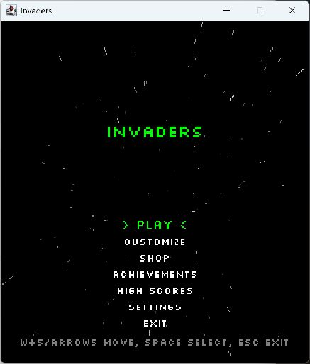

# Release automation verification (HW-42)

Verified on 2026-11-09 (Asia/Seoul) against commit
`0467dd34bfad4ef634857803e52dae1e90aa91cc`.

## Result and scope

The release workflow completed successfully, published the expected runnable
JAR, and the downloaded artifact matched GitHub's SHA-256 digest. A local launch
on Windows with Temurin JDK 17.0.20.1+1 displayed the title screen, sprites, fonts,
and menu correctly. This verifies packaging and startup; it does not establish
that gameplay or save persistence works.

This audit did not dispatch a workflow or change a workflow, tag, release,
repository setting, or existing user save. The test process was stopped after
verification. Fixed sprint release conventions remain a separate HW-41 proposal.

## Workflow checks

The [workflow at the tested commit](https://github.com/eoieiie/hello-world-invaders/blob/0467dd34bfad4ef634857803e52dae1e90aa91cc/.github/workflows/release.yml)
has the following configuration:

| Check | Observed configuration |
| --- | --- |
| Trigger | Push to `main` and manual execution; no tag-push trigger |
| Repository guard | `eoieiie/hello-world-invaders` |
| Build | Temurin JDK 17; compile sources and copy resources into `bin` |
| Package | `Invaders.jar`, with `engine.Core` as its main class |
| Startup check | Run the JAR under Xvfb for up to 10 seconds; reject an `Exception` in the log or a missing title-screen message |
| Publication | Replace the `latest` release and tag at `GITHUB_SHA`, marked as a prerelease |
| Permissions | `contents: write`, with `github.token` supplied as `GH_TOKEN` |
| Concurrency | Group `release`, with `cancel-in-progress: true` |

No repository-guard change is needed for the current team repository.

## Successful run and artifact

- [Actions run 42500924790](https://github.com/eoieiie/hello-world-invaders/actions/runs/42500924790), triggered by a push, completed successfully.
- The [jar job](https://github.com/eoieiie/hello-world-invaders/actions/runs/42500924790/job/128793279727) passed the build, startup check, and publication steps.
- The source was [commit 0467dd3](https://github.com/eoieiie/hello-world-invaders/commit/0467dd34bfad4ef634857803e52dae1e90aa91cc).
- The observed [latest release](https://github.com/eoieiie/hello-world-invaders/releases/tag/latest) was titled **Latest build from main**, release ID `438374386`, and targeted that commit.
- Its asset was `Invaders.jar`, asset ID `724531515`, size **6,050,953 bytes**.
- GitHub's digest and the downloaded file's digest both matched:

```text
SHA-256 e50a08c9e8c4cb8bff1ef92cd40a6157a529cdbc7b3487a0cad9192bcab96705
```

The `latest` tag and [download link](https://github.com/eoieiie/hello-world-invaders/releases/download/latest/Invaders.jar)
are mutable. Future downloads must be checked against their own release commit
and digest; the values above describe the artifact observed during this audit.

## Local launch evidence

The JAR was launched with `java -jar Invaders.jar` using JDK 17. Its working
directory, JAR location, and `user.home` were isolated from the original checkout
and existing saves. The title screen was directly observed, and the startup log
contained the following messages without an exception:

```text
[INFO|12:44:31]: Started loading resources.
[INFO|12:44:31]: Finished loading the sprites.
[INFO|12:44:31]: Finished loading the fonts.
[INFO|12:44:31]: Starting 448x520 title screen at 60 fps.
```

Standard output was empty. The specific test process was stopped after the check.



## Limits and follow-up

- Neither the automated startup check nor this local title-screen check covers
  menu navigation, game-over, scoring, items, achievements, complete levels, or
  save persistence.
- Manual execution can select a branch other than `main`; the job has a
  repository guard but no separate branch guard. HW-41 proposes selecting `main`
  for a release, but that convention is not approved by this audit.
- The workflow comments and published release notes still say the project font
  is not committed. This guidance is stale: the repository includes Silkscreen
  and its OFL license, and
  [FileManager selects Silkscreen-Regular.ttf](https://github.com/eoieiie/hello-world-invaders/blob/0467dd34bfad4ef634857803e52dae1e90aa91cc/src/engine/FileManager.java).
  Correcting that wording should be a separately reviewed change.

Jira status, evidence posting, and actual time remain to be recorded separately.
